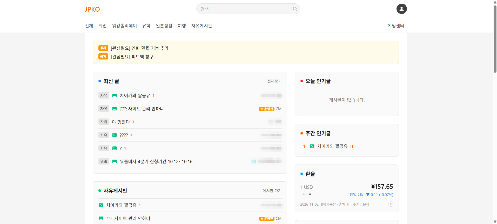
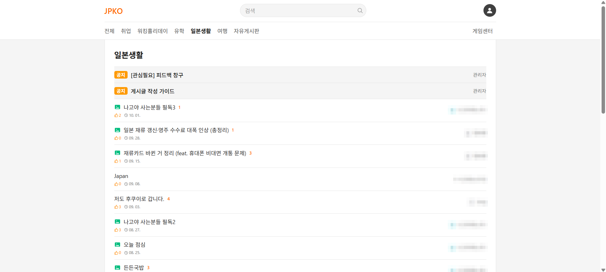
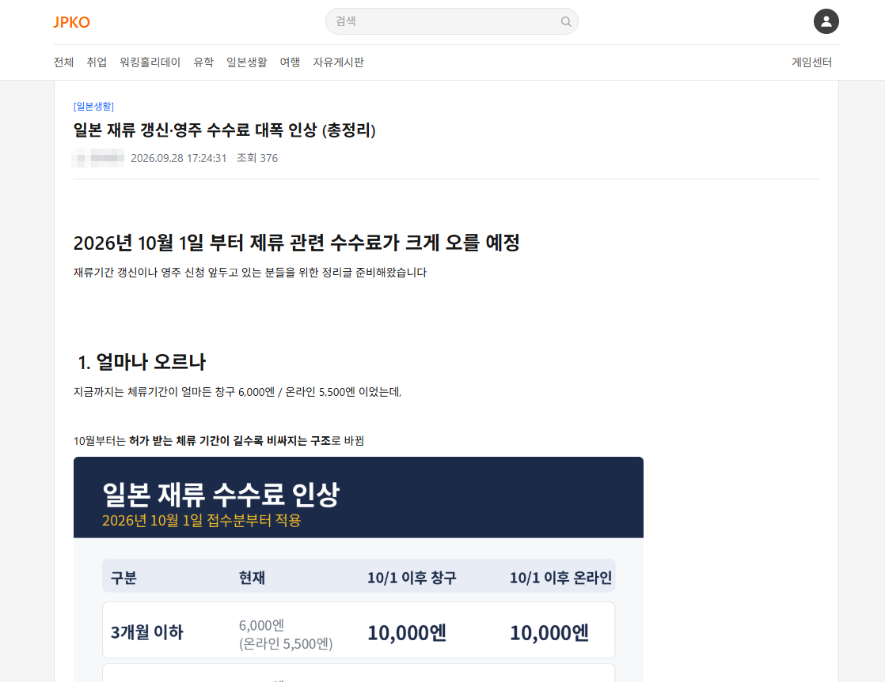
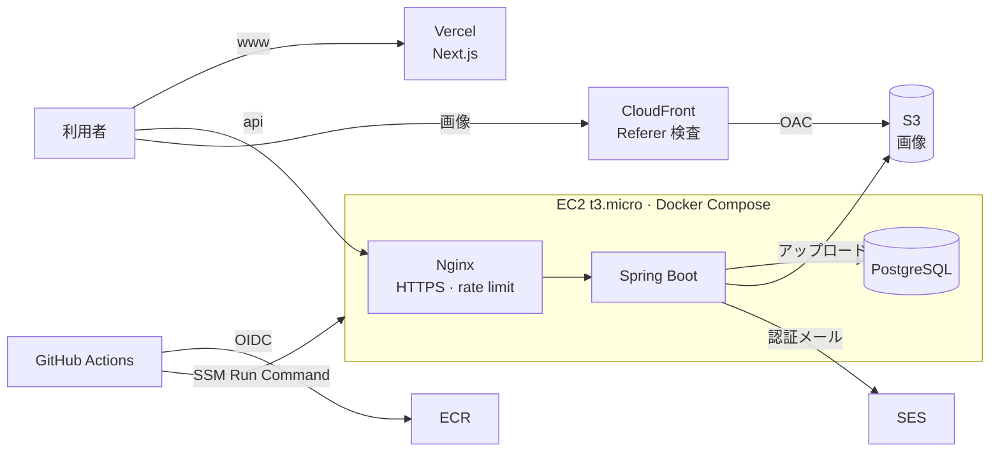

# jpkocommunity — Backend

**日本語** | [한국어](README.ko.md)

日本での就職・ワーキングホリデー・留学・日本生活・旅行に関心のある韓国人向けコミュニティサービスのバックエンドです。
企画から設計、開発、AWS インフラ構築、デプロイ、運用までを1人で行いました。

> **📦 運用終了のお知らせ**
> 本サービスは2026年6月から11月まで実際に運用し、**2026-11-25 に運用を終了**しました。
> 投稿は作成者情報を除いた読み取り専用のアーカイブとして保存し、会員の個人情報は終了日にすべて破棄しました。
> このリポジトリは開発記録として残しています。

- フロントエンド: [ahdeka/jpko-community-frontend](https://github.com/ahdeka/jpko-community-frontend)
- サービス: https://www.jpkocommunity.site (アーカイブ)

---

## 設計書

運用終了前に、実装コードと本番環境をもとに日本の SI 形式で作成した設計資料です。資料内の画面の文言はサービスの表示言語である韓国語です。

| 資料 | 内容 | 形式 |
| --- | --- | --- |
| [基本設計書](docs/design/basic-design.pdf) | システム構成図、ソフトウェア構成、ER 図、認証方式、非機能設計、デプロイ方式、外部連携 | PDF |
| [詳細設計書](docs/design/detailed-design.pdf) | 会員登録(メール先行認証)、トークンとマルチデバイス、メディア変換、連続投稿の制限、ポイント台帳と排他制御、人気投稿、コメント削除と退会 | PDF |
| [API仕様書](docs/design/api-spec.pdf) | REST API 76本の入出力・エラー・権限 | PDF |
| [画面遷移図](docs/design/screen-transition.pdf) | 全画面の遷移図、遷移一覧、アクセス制御 | PDF |
| [画面設計書](docs/design/screen-design.pdf) | 31画面と共通部品の画面イメージ・項目定義 | PDF |
| [テーブル定義書](docs/design/table-definition.xlsx) | 15テーブルのカラム・インデックス・制約、コード定義、マイグレーション履歴 | Excel |
| [機能一覧](docs/design/function-list.xlsx) | 機能51件、画面一覧、バッチ一覧 | Excel |

---

## スクリーンショット

| メイン | カテゴリ |
|---|---|
|  |  |

| 投稿詳細 | 管理ダッシュボード |
|---|---|
|  |  |

> 会員のニックネームと IP の表示は、個人情報保護のためモザイク処理しています。

---

## 技術スタック

| 領域 | 技術 |
|---|---|
| Language / Framework | Java 21, Spring Boot 3.5, Spring Security, Spring Data JPA |
| Auth | JWT (Access 1h / Refresh 7d), HttpOnly Cookie, Refresh Token の DB 保存(マルチデバイス) |
| DB | PostgreSQL 16, Flyway (V1 ~ V55) |
| Infra | AWS EC2 (t3.micro), ECR, S3 + CloudFront (OAC), SES, SSM (Parameter Store / Session Manager / Run Command) |
| Web Server | Nginx (リバースプロキシ、`limit_req` によるレート制限), Let's Encrypt |
| CI/CD | GitHub Actions (OIDC) → ECR → SSM Run Command |
| その他 | Cloudflare Turnstile, ffmpeg / cwebp / gif2webp, jsoup |

## アーキテクチャ



---

## 主な機能

- **掲示板**: 6カテゴリ、検索、人気投稿、お知らせ、閲覧数の水増し防止
- **コメント**: 投稿とお知らせで共通に使うポリモーフィック構造(`target_type` + `target_id`)、コメント画像
- **会員**: メール認証後の登録、ID・パスワード検索、メールアドレス変更時の再認証、公開プロフィール、レベル制度
- **アップロード**: 画像は最大10枚、動画は最大3本、サーバー側での形式変換
- **コミュニティ管理**: 投稿・コメント・ユーザーの通報、管理者による処理、期間付き利用停止
- **通知**: コメント、推薦、レベルアップ、コンテンツ削除など(SSE でリアルタイム配信)
- **その他**: ポイント、出席、ミニゲーム

---

## 設計で工夫した点

### 1. 登録前のメール認証(ハードゲーティング)
当初は登録後に未認証状態の User を作っていましたが、未認証アカウントが溜まり、すべての機能に「認証済みか」の分岐が必要になりました。
そこで **認証が終わってから User の行を作る** 方式に変えました。認証前は別の pre-signup トークンだけが存在します。(V22, V52)

### 2. 連続投稿の防止をアプリケーションロックなしで
同じユーザーが同時に複数のリクエストを送ると、「直近 N 秒以内に投稿したか」の確認をすべて通過してしまいます。
Redis などの分散ロックを追加する代わりに、**PostgreSQL の `pg_advisory_xact_lock`** でユーザー単位に直列化しました。トランザクションが終わるとロックも自動で外れます。
制限値は `application.yaml` の1か所で管理しています(SSOT)。

### 3. アップロードファイルの検証と変換
- 拡張子や Content-Type はクライアントが変えられるため、**マジックバイト** で実際のファイル形式を検証します。
- 容量を減らすためにサーバーで変換します。jpg → WebP、gif → アニメーション WebP、mov/mp4 → H.264 720p。
- 変換器は `MediaConverter` インターフェースで分離して形式ごとに差し替えられるようにし、メモリ 1GB の t3.micro で ffmpeg が同時に動かないよう、セマフォで1件ずつ処理します。

### 4. 通信費用の防御
1人で運用するうえで一番怖かったのは、予期しない課金でした。
- S3 への直接アクセスを閉じ、**CloudFront + OAC** 経由でのみ配信します。
- CloudFront Functions で **Referer を検査し、外部サイトからの直リンクを遮断** します。
- API は Nginx の `limit_req` でレート制限しています。(アプリケーションレベルの Bucket4j は検討のうえ見送り)

### 5. スキーマ変更履歴の管理
初期は `ddl-auto: update` を使っていましたが、本番 DB で何がいつ変わったのかを追えませんでした。
**Flyway** に移行してから、55本のマイグレーションですべての変更を記録しました。機能を取り除くときも、テーブルの DROP までマイグレーションとして残しています。(V46)

### 6. デプロイパイプライン
- GitHub Actions から **OIDC** で AWS のロールを受け取り、長期のアクセスキーを GitHub に保存しません。
- イメージは ECR に上げ、EC2 には **SSM Run Command** でデプロイ命令を送ります。SSH ポート(22)は閉じています。
- デプロイ後のヘルスチェックに失敗すると、**直前のイメージへ自動でロールバック** します(`deploy.sh`)。
- DB への接続も SSM のポートフォワーディングでのみ行います。

### 7. 個人情報の最小保管
- 投稿者の IP は、6か月を過ぎたものをスケジューラで匿名化します。
- 退会した会員のログイン情報はマイグレーションで整理しました。(V54)

---

## プロジェクト構成

```
src/main/java/com/jpkocommunity
├── domain                 # ドメイン別の controller / service / repository / entity / dto
│   ├── auth               # ログイン、登録、トークン、メール認証
│   ├── user · level       # 会員、レベル
│   ├── post · comment · like · category · notice
│   ├── report             # 通報、利用停止
│   ├── notification
│   └── point · checkin    # ポイント、出席
└── global
    ├── security           # JWT フィルター、公開パスの定義
    ├── infra              # S3、メディア変換
    ├── config             # 設定プロパティ(SSOT)
    └── exception · response · scheduler
```

## ローカル実行

```bash
# 1. DB
docker compose up -d

# 2. アプリ(必須の環境変数: DB_USER, DB_PASSWORD, JWT_SECRET)
./gradlew bootRun
```

S3、SES、Turnstile 関連の値がない場合、アップロードとメール送信は動作しません。

---

## 振り返り

- **良かった点**: 費用とセキュリティを最初から一緒に考えました。運用期間中の月額費用は $15~20 程度に抑え、課金事故はありませんでした。
- **反省点**: ショップ・オークション・ポイント送金のような付加機能を早く入れすぎて、後で取り除きました(V25~V46)。中心となる情報共有の機能に先に集中すべきでした。
- **学んだこと**: 機能を作ることより、1人で運用し続けられる構造を作るほうが難しいということ。
