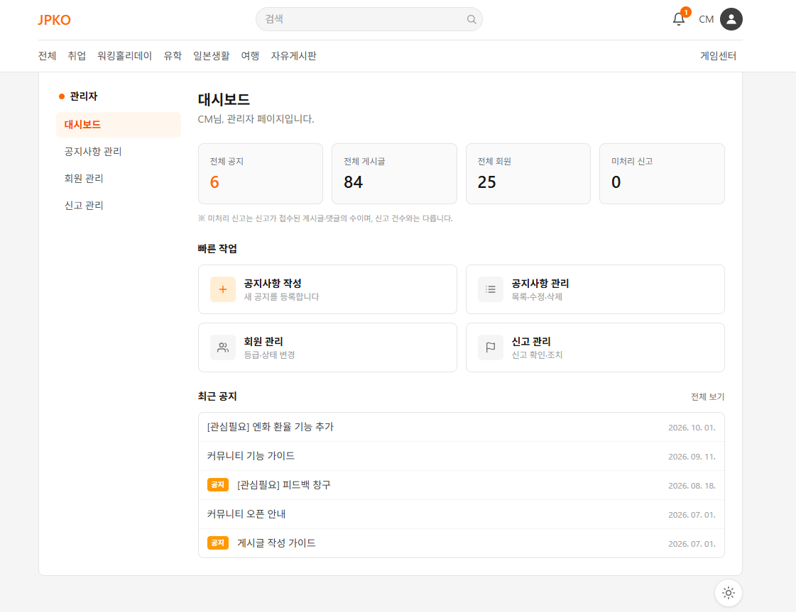
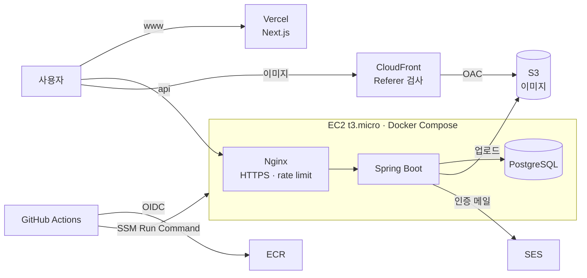

# jpkocommunity — Backend

일본 취업 · 워킹홀리데이 · 유학 · 일본생활 · 여행에 관심 있는 한국인을 위한 커뮤니티 서비스의 백엔드입니다.
기획부터 설계, 개발, AWS 인프라 구축, 배포, 운영까지 1인으로 진행했습니다.

> **📦 운영 종료 안내**
> 이 서비스는 2026년 6월부터 11월까지 실제로 운영되었고, **2026-11-25에 운영을 종료**했습니다.
> 게시글은 작성자 정보를 제거한 읽기 전용 아카이브로 보존되어 있으며, 회원 개인정보는 종료일에 모두 파기했습니다.
> 이 레포는 개발 기록으로 남겨둡니다.

- 프론트엔드: [ahdeka/jpko-community-frontend](https://github.com/ahdeka/jpko-community-frontend)
- 서비스: https://www.jpkocommunity.site (아카이브)

---

## 스크린샷

| 메인 | 카테고리 |
|---|---|
|  |  |

| 게시글 상세 | 관리자 대시보드 |
|---|---|
|  |  |

> 회원 닉네임과 IP 표시는 개인정보 보호를 위해 모자이크 처리했습니다.

---

## 기술 스택

| 영역 | 기술 |
|---|---|
| Language / Framework | Java 21, Spring Boot 3.5, Spring Security, Spring Data JPA |
| Auth | JWT (Access 1h / Refresh 7d), HttpOnly Cookie, Refresh Token DB 저장 (멀티 디바이스) |
| DB | PostgreSQL 16, Flyway (V1 ~ V55) |
| Infra | AWS EC2 (t3.micro), ECR, S3 + CloudFront (OAC), SES, SSM (Parameter Store / Session Manager / Run Command) |
| Web Server | Nginx (리버스 프록시, `limit_req` rate limiting), Let's Encrypt |
| CI/CD | GitHub Actions (OIDC) → ECR → SSM Run Command |
| 기타 | Cloudflare Turnstile, ffmpeg / gif2webp, jsoup |

## 아키텍처



---

## 주요 기능

- **게시판**: 6개 카테고리, 검색, 인기글, 공지사항, 조회수 어뷰징 방지
- **댓글**: 게시글과 공지에 공통으로 쓰는 폴리모픽 구조 (`target_type` + `target_id`), 댓글 이미지
- **회원**: 이메일 인증 후 가입, 아이디/비밀번호 찾기, 이메일 변경 재인증, 공개 프로필, 레벨 시스템
- **업로드**: 이미지 최대 10장, 동영상 최대 2개, 서버 측 포맷 변환
- **커뮤니티 관리**: 게시글 · 댓글 · 유저 신고, 관리자 처리, 기간 정지
- **알림**: 댓글, 좋아요, 레벨업, 콘텐츠 삭제 등
- **기타**: 포인트, 출석체크, 미니게임

---

## 설계하면서 고민한 것들

### 1. 가입 전 이메일 인증 (하드 게이팅)
처음에는 가입 후 미인증 상태로 User를 만들었는데, 미인증 계정이 쌓이고 모든 기능에 "인증했는가" 분기가 필요해졌습니다.
그래서 **인증이 끝나야 User row를 생성**하는 방식으로 바꿨습니다. 인증 전에는 별도의 pre-signup 토큰만 존재합니다. (V22, V52)

### 2. 도배 방지를 애플리케이션 락 없이
같은 유저가 동시에 여러 요청을 보내면 "최근 N초 내 작성 여부" 검사를 모두 통과할 수 있습니다.
Redis 같은 분산 락을 추가하는 대신, **PostgreSQL `pg_advisory_xact_lock`**으로 유저 단위 직렬화를 했습니다. 트랜잭션이 끝나면 락도 자동으로 풀립니다.
제한 값은 `application.yaml` 한 곳에서 관리합니다 (SSOT).

### 3. 업로드 파일 검증과 변환
- 확장자나 Content-Type은 클라이언트가 바꿀 수 있어서, **매직바이트**로 실제 파일 형식을 검증합니다.
- 용량을 줄이기 위해 서버에서 변환합니다. jpg/png → webp, gif → webp, mov/mp4 → H.264 720p.
- 변환기는 `MediaConverter` 인터페이스로 분리해 형식별로 교체할 수 있게 했고, 메모리가 1GB인 t3.micro에서 ffmpeg가 동시에 돌지 않도록 세마포어로 1개씩 처리합니다.

### 4. 트래픽 비용 방어
1인 운영에서 가장 무서운 건 예상하지 못한 과금이었습니다.
- S3는 직접 접근을 막고 **CloudFront + OAC**로만 제공합니다.
- CloudFront Functions로 **Referer를 검사해 외부 핫링킹을 차단**합니다.
- API는 Nginx `limit_req`로 rate limiting을 합니다. (애플리케이션 레벨 Bucket4j는 검토 후 보류)

### 5. 스키마 변경 이력 관리
초기에는 `ddl-auto: update`를 썼지만 운영 DB에 무엇이 언제 바뀌었는지 추적할 수 없었습니다.
**Flyway**로 전환한 뒤 55개의 마이그레이션으로 모든 변경을 기록했습니다. 기능을 걷어낼 때도 테이블 DROP까지 마이그레이션으로 남겼습니다. (V46)

### 6. 배포 파이프라인
- GitHub Actions에서 **OIDC**로 AWS 역할을 받아, 장기 Access Key를 GitHub에 저장하지 않습니다.
- 이미지는 ECR에 올리고, EC2에는 **SSM Run Command**로 배포 명령을 보냅니다. SSH 포트(22)는 닫았습니다.
- 배포 후 헬스체크에 실패하면 **이전 이미지로 자동 롤백**합니다 (`deploy.sh`).
- DB 접속도 SSM 포트포워딩으로만 합니다.

### 7. 개인정보 최소 보관
- 조회수 중복 방지에 쓴 IP는 스케줄러로 주기적으로 삭제합니다.
- 탈퇴한 회원의 로그인 정보는 마이그레이션으로 정리했습니다. (V54)

---

## 프로젝트 구조

```
src/main/java/com/jpkocommunity
├── domain                 # 도메인별 controller / service / repository / entity / dto
│   ├── auth               # 로그인, 가입, 토큰, 이메일 인증
│   ├── user · level       # 회원, 레벨
│   ├── post · comment · like · category · notice
│   ├── report             # 신고, 정지
│   ├── notification
│   └── point · checkin    # 포인트, 출석
└── global
    ├── security           # JWT 필터, 공개 경로 정의
    ├── infra              # S3, 미디어 변환
    ├── config             # 설정 프로퍼티 (SSOT)
    └── exception · response · scheduler
```

## 로컬 실행

```bash
# 1. DB
docker compose up -d

# 2. 앱 (필수 환경변수: DB_USER, DB_PASSWORD, JWT_SECRET)
./gradlew bootRun
```

S3, SES, Turnstile 관련 값이 없으면 업로드와 메일 발송 기능은 동작하지 않습니다.

---

## 회고

- **잘한 것**: 비용과 보안을 처음부터 같이 고민했습니다. 운영 기간 동안 월 비용은 $15~20 수준을 유지했고, 과금 사고는 없었습니다.
- **아쉬운 것**: 포인트 · 경매 · 미니게임 같은 부가 기능을 너무 일찍 넣었다가 다시 걷어냈습니다 (V25~V46). 핵심인 정보 공유 기능에 먼저 집중했어야 했습니다.
- **배운 것**: 기능을 만드는 것보다 1인이 계속 운영할 수 있는 구조를 만드는 게 더 어렵다는 것.
